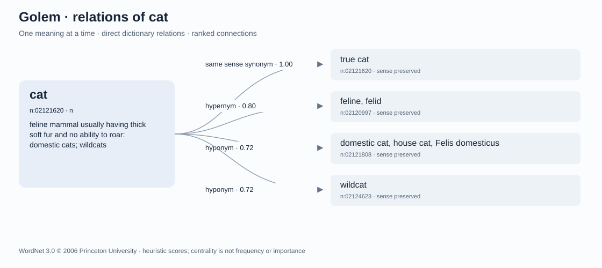

# Dictionary relations and neural learning

Golem keeps a queryable lexical graph and a neural training corpus as separate
artifacts. Graph queries return stored source relationships. Neural evaluation
measures what a checkpoint predicts from a question, without substituting a
dictionary answer for its output.



The displayed scores are fixed relation/path heuristics. The full graph and
all-word connectivity table can be exported as GraphML and TSV; pairwise paths
are searched on demand rather than storing a dense matrix of every word pair.

## Source and license

The source is **Princeton WordNet 3.0**, distributed through the official NLTK
data repository at revision `96f9b3252457a2b97e52aec64c3dfceeb5c312d5`.
The [pinned archive](https://raw.githubusercontent.com/nltk/nltk_data/96f9b3252457a2b97e52aec64c3dfceeb5c312d5/packages/corpora/wordnet.zip)
is 10,775,600 bytes and has SHA-256
`cbda5ea6eef7f36a97a43d4a75f85e07fccbb4f23657d27b4ccbc93e2646ab59`.

The parser retains distinct sense concepts, their lemmas, parts of speech and
definitions, plus typed pointers between concepts. Lexical pointers retain the
specific source and target lemmas. A word with several meanings therefore has
several concept IDs; its meanings are not merged into one node. The format is
documented in [Princeton's database specification](https://wordnet.princeton.edu/documentation/wndb5wn).

The full graph built for this experiment contains 117,659 concepts, 147,306
normalized lemma entries and 377,592 typed edges, including 92,244 lexical
edges. These are different counts: a lemma is not necessarily one word sense,
and an edge is not necessarily a synonym relationship.

WordNet's copyright and permission notice is copied as `WORDNET-LICENSE.txt`
beside both the graph and the relation corpus. Keep that notice when distributing
derived data. It is distinct from Golem's code license. See the
[WordNet license](https://wordnet.princeton.edu/license-and-commercial-use).
Downloaded source data and generated corpora remain outside tracked source files.

## Sense-preserving facts

The corpus emits only definitions, same-sense synonym examples, hypernyms and
hyponyms, instance/class relations, part/member/substance relations, and explicit
lexical antonyms. Every answer has a source node or edge in a saved graph snapshot.
Synonyms come from a single synset; an antonym pointer between specific lemmas is
never extended to every lemma in their synsets.

Questions identify the sense ID and part of speech. Definition questions do not
include the definition answer in their prompt. Other relation questions include
a source-definition hint to disambiguate the meaning. A shortened hint ends with
an explicit ellipsis. Some target lemmas already occur in those hints; each fact
records `answer_visible_in_prompt` so contextual extraction can be reported
separately from answers requiring additional learned information.

To retain complete questions during recurrent training, selected concepts have
full definitions no longer than 160 UTF-8 bytes. Prompts are at most 200 bytes,
answers at most 160. Long definitions are excluded instead of silently truncating
the answer. The theoretical maximum is 364 byte/role tokens. The prepared
6,000-concept corpus actually reaches only **257 training, 241 validation and
247 test tokens** per complete conversation. A sequence length of 384 retains
every full question and answer in this corpus.

The default selection starts with a declared list of familiar lemma seeds,
adds a bounded one-hop neighborhood, and fills remaining capacity with seeded
uniform concept selection. The seed list is hand-written; it is not an empirical
word-frequency ranking. Source glosses, raw triples, generated facts, unique
conversations and their rendered texts remain available for inspection.

## Partitions and curriculum

Concept IDs are assigned to approximately 80% training, 10% validation and 10%
test **before** generating questions or computing training ranks. An edge can
produce a training example only when both endpoints belong to training. The same
rule applies to validation and test. Synonyms, inverse relations and alternative
questions about one concept cannot move that concept into another partition.

The prepared corpus uses seed 23 and 6,000 concepts, with no dialogue mixture:

| Partition | Concepts | Unique factual conversations | Documents presented to the sampler | Longest complete token sequence |
|---|---:|---:|---:|---:|
| Training | 4,800 | 9,510 | 14,923 | 257 |
| Validation | 600 | 899 | 899 | 241 |
| Test | 600 | 1,009 | 1,009 | 247 |

There are 4,300 excluded edges crossing these concept partitions. The loader
reconstructs facts from the saved source snapshot and verifies their endpoint
partitions, licenses, hashes and sampling multiplicities.

For training, PageRank is recomputed using only the 4,800 training concepts and
their internal edges. Full-graph ranks are available for graph inspection but
are never used for the training curriculum. Every unique training fact appears
once. Facts from the highest-ranked 30% of source concepts receive one extra
copy; those in the highest-ranked 10% receive a second extra copy. No fact gets
more than three copies. Outgoing relation examples are also capped per concept
and per relation type.

This is a static mixture of uniform coverage and bounded rank-weighted rehearsal.
The neural sampler already samples uniformly over documents, so repeated entries
implement the declared weights. They are not reported as new independent facts.
In this corpus, the mandatory uniform copy accounts for approximately **63.7%**
of training documents. Validation and test examples are never repeated for rank.

Synset-disjoint does not mean word-disjoint: the same spelling may occur with
different meanings across partitions. A warm-started language model may also
have encountered these words or facts during earlier English training. These
are held-out concepts for this graph-training stage, not a claim of complete
ignorance before that stage. Compare the frozen starting checkpoint with the
fine-tuned checkpoints on the same validation cases.

An optional `--dialogue` corpus can contribute at most 25% of the resulting
documents in each partition. Its original conversation-tree partitions are
retained, and known exact held-out definitions or explicit held-out sense IDs
are removed from its training contribution. This does not rule out every kind
of semantic overlap in free-form dialogue. The default experiment omits this mix.

## Three distinct kinds of ranking

`graph rank` aggregates full-graph PageRank across a lemma's senses. It describes
connectivity in this particular resource, not word frequency, truth, usefulness
or universal importance. Having more indexed meanings can affect that aggregate.

`graph related` and `graph pair` use typed paths and declared heuristic weights.
Their scores describe graph relatedness under search bounds, not probabilities
or a general semantic-similarity scale. An antonym is a meaningful relationship
expressing opposition. A missing bounded path does not prove two concepts are
unrelated. Inspect the returned sense IDs and definitions; provide explicit
senses when the defaults choose the wrong meaning.

The training curriculum uses a third quantity: PageRank on the training-only
induced subgraph. That quantity changes exposure frequency by at most threefold;
it does not change source labels or make a statement more correct.

## Commands

Run from the project checkout. Graph preparation and inspection use the standard
library; neural commands require the project's isolated Torch environment.

```bash
python -m english_world graph build --output data/lexicon
python -m english_world graph rank --graph data/lexicon/graph.json --top 20
python -m english_world graph related bank --limit 10
python -m english_world graph pair cat animal --max-hops 4
python -m english_world graph export --word cat --output data/lexicon/cat-neighborhood.svg
python -m english_world graph corpus --graph data/lexicon/graph.json --output data/relations --seed 23 --max-concepts 6000
```

`graph related` displays the available senses. Its `--sense` option, and the
pair command's `--source-sense` and `--target-sense` options, select exact meanings.
Use the IDs returned by the graph; they are tied to this WordNet version.

The relation training configuration expects the deliberately chosen frozen
starting checkpoint at `runs/seeds/relation-base.pt`. Both comparison arms start
from that checkpoint. Once it has been placed there and the runtime is ready,
the guarded Linux launcher is:

```bash
bash ops/run_neural.sh relations runs/neural-relations
python -m english_world neural status --run-dir runs/neural-relations
```

The configuration uses sequence length 384 and matches update/token budgets
between ordinary fine-tuning and population-based training. This does not
equalize total CPU time. Read the report's actual costs and completion status
before comparing outcomes; a time-limited partial run is not a completed match.

Both arms receive the same ranked graph corpus. This comparison tests whether
population-based training helps on that corpus. It does not isolate the benefit
of graph data versus dialogue alone, or ranked versus uniform sampling.

The first Specht32 run began on 2026-10-10 at 22:32 CEST in
`runs/neural-relations`, with 1,600 updates per arm and a 20-minute training
limit. It inherits the completed language run's ordinary champion, chosen by
its lower validation loss, with a fresh optimizer in every candidate. The frozen
checkpoint SHA-256 is
`cc1f935efb12cb39e86ee501264166ebfaf17bf30b98210ca4e613d5a767ed7d`.
Runtime reports and checkpoints are written under the run directory.

Evaluate the starting point and a resulting champion using the same validation
cases:

```bash
python -m english_world neural relation-eval --checkpoint runs/seeds/relation-base.pt --data data/relations/dataset.json --split validation --cases 256 --output runs/relation-base-validation.json
python -m english_world neural relation-eval --checkpoint runs/neural-relations/ordinary_champion.pt --data data/relations/dataset.json --split validation --cases 256 --output runs/relation-ordinary-validation.json
```

Repeat for `evolution_champion.pt` when that arm has produced a checkpoint. Use
test results for a final selected experiment, not for repeated model selection.
The evaluator scores teacher-forced answer likelihood and contrasts a true answer
with a same-relation distractor. The full graph helps reject distractors that are
also valid; its answer is never fed into the neural prompt as a hidden retrieval
result. These are diagnostic likelihood measures, not free-generation accuracy.

Report case counts by relation and prompt visibility. This particular test split
has only two antonym examples, and validation has none; those samples cannot
support broad claims about antonym knowledge. Definitions and synonyms dominate
the dataset, so an improved aggregate score alone is insufficient evidence of
learning every relation type.

## Prepared artifact identities

The manifest records these identities for the corpus prepared on 2026-10-10:

| Artifact | SHA-256 |
|---|---|
| Complete source graph JSON | `0e928d5834ff6410d86ac8917bde0a445620ca06253288c0898de844ded88fad` |
| Selected graph snapshot | `7d3c46ad76ece9a04cba5b82834ed28080ba85d379896cfdd5d9564952e05bcb` |
| Canonical corpus content, excluding manifest | `9d65856e81874893e970f2af363843971fe56b497673e215c2049f46063ed0ef` |
| Prepared dataset file bytes | `699111b4815b1cbb93caa723fe0f604e2bac254fbd8d1d8b05679bbee0025c12` |

Graph retrieval working correctly establishes that the stored resource is
accessible. Better neural scores after fine-tuning establish a narrower learning
result under the chosen measurements. Neither result alone establishes general
understanding, unrestricted self-improvement or open-ended evolution.
